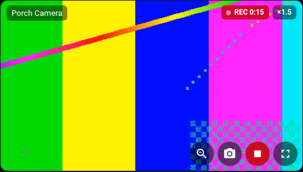

# HA Plooum Camera Card

`type: custom:ha-plooum-camera-card`

A live camera that **plays as soon as the card shows**, with a **digital zoom**, and **photo / video buttons** that save on the Home Assistant server. When the camera fails, the card shows its **fallback stream** (the camera's low definition stream, for instance), then the **last good picture** of the camera with the reason.



## The stream

The card uses Home Assistant's own player: WebRTC or HLS for cameras with a stream, refreshed pictures (MJPEG) for the others. Sound is off unless `muted: false`.

## Zoom

- **Wheel**, **pinch** or **double tap / double click** zoom in where the pointer is (double tap again to come back).
- Once zoomed, **drag** to move around; the picture always fills the frame.
- The **magnifier** button resets the zoom. `max_zoom` limits it (`1` disables it).
- The **full screen** button shows the card alone on the screen (where the browser allows it).

While the picture isn't zoomed, a finger can still scroll the page over the card.

## When the camera fails

The card checks the shown stream every two seconds. It counts as failing when:

| Reason shown | When |
| :--- | :--- |
| Camera unavailable / Camera not found | The camera entity is `unavailable` or doesn't exist |
| No stream | No picture after 20 s, or the player gives up |
| Stream stalled | A video that stops for 12 s, or pictures that don't change for 30 s |
| Black picture | Three black pictures in a row (6 s) |

Then it shows, in this order:

1. the **fallback stream** `sd_entity`, with an **SD** badge;
2. the **preview picture** `preview_entity` (an `image` entity), with the reason and the time of the picture. [Plooum CamPreview](https://github.com/plooum/HA-Plooum-CamPreview) keeps such a picture for each camera (`image.<camera>_preview`): the last good one, never black or of a turned camera;
3. without a preview picture, a placeholder with the reason.

A failed stream is tried again in the background, hidden: 3 s after it failed, then every minute, and at once when its entity becomes available again. It comes back as soon as it plays and isn't black, so the card never flickers between a stream that works and one that doesn't.

The checks pause while the card is out of sight or the page is in the background: browsers pause a muted video nobody sees.

## Photos and videos

The **photo** and **record** buttons need the [Plooum CamRecorder](https://github.com/plooum/HA-Plooum-CamRecorder) integration, which saves them on the Home Assistant server (sorted by camera and day, in the media browser, purged automatically). Without it, they don't show.

- **Photo** (`plooum_camrecorder.snapshot`): a flash and "Photo saved".
- **Record** starts a video (`plooum_camrecorder.start_recording`); a red **REC** badge counts its time; the same button (now a stop square) stops it (`plooum_camrecorder.stop_recording`). The integration stops a forgotten video after 10 minutes.
- They act on the stream shown: the fallback stream's camera while it shows, nothing while the preview picture shows.
- The record button follows the camera's **Recording** switch of CamRecorder (when the camera is picked in the integration's options): a video started by an automation or another screen shows here too. For another camera, the card follows the videos it started itself.

Photos are of the whole picture, whatever the zoom.

## Configuration Parameters

| Parameter | Type | Default | Description |
| :--- | :--- | :--- | :--- |
| `type` | string | **Required** | `custom:ha-plooum-camera-card` |
| `entity` | string | **Required** | The camera |
| `sd_entity` | string | none | Fallback camera, shown when `entity` fails (typically its substream) |
| `preview_entity` | string | none | `image` entity shown when no stream plays, e.g. `image.<camera>_preview` of Plooum CamPreview. Also shown, with a spinner, while a stream starts (a camera's HLS stream can take several seconds to show its first picture) |
| `name` | string | the camera's name | Name shown at the top left |
| `show_name` | boolean | `true` | Show the name |
| `aspect_ratio` | string | `16:9` | Shape of the card (`16:9`, `4:3`, `1:1`…) |
| `fit` | string | `contain` | `contain` shows the whole picture, `cover` fills the card (crops) |
| `max_zoom` | number | `5` | Maximum zoom; `1` disables the zoom |
| `muted` | boolean | `true` | Sound off |
| `show_controls` | boolean | `true` | Show the buttons (photo, record, zoom reset, full screen) |

## Examples

```yaml
type: custom:ha-plooum-camera-card
entity: camera.porch
sd_entity: camera.porch_sub
preview_entity: image.porch_preview
```

```yaml
type: custom:ha-plooum-camera-card
entity: camera.garden
aspect_ratio: "4:3"
fit: cover
show_name: false
max_zoom: 8
```
