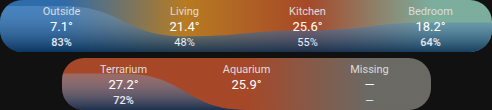

# HA Plooum Climate Band Card

`type: custom:ha-plooum-climate-band-card`

Every room's temperature and humidity in a single band, to keep the top of a dashboard compact:

- the band's **color glides from room to room with the temperature**, from cold blue to hot coral;
- a **water table rises inside it with the humidity**, one smooth curve across the rooms, darker towards the bottom;
- a humidity **above the threshold pulses in red** (only the value: the band itself stays calm).



## Layout

On a wide card, all the rooms sit on one line. When a room would get less than `min_room_width` pixels (a phone, a narrow column), the band splits into **two lines**: the first half of the rooms on top (the larger half for an odd count), the rest underneath, **centered**, with the same room width. Each room then shows its name, temperature and humidity on three lines.

| Temperature | Color |
| :--- | :--- |
| below 12 ° | blue |
| 12 to 18 ° | light blue |
| 18 to 20 ° | teal |
| 20 to 22 ° | amber |
| 22 ° and above | coral |

A room whose temperature is unavailable, unknown, missing or not a number shows a dash, in gray. A room without a humidity sensor (or whose humidity is not a number) has no water under it.

## History

A tap on a room opens its history in a dialog:

- the **temperature** as a line, in the band's colors;
- the **humidity** as the same water table, with the alert threshold as a dashed red line;
- **6 h, 24 h, 7 d or 30 d**: the last 6 and 24 hours come from the recorder's states, 7 and 30 days from its hourly statistics (the sensors need a `state_class`, otherwise the card falls back to the states, which the recorder keeps 10 days by default);
- move over (or touch) the chart to read the values at a given time;
- a tap on a value in the dialog's header opens that sensor's own dialog.

## Configuration Parameters

| Parameter | Type | Default | Description |
| :--- | :--- | :--- | :--- |
| `type` | string | **Required** | `custom:ha-plooum-climate-band-card` |
| `rooms` | list | **Required** | The rooms, from left to right (see below) |
| `threshold` | number | `60` | Humidity (%) above which the value pulses in red |
| `pulse` | boolean | `true` | Pulse the alert; `false` keeps it red and still. The pulse also stops when the system asks for reduced motion |
| `humidity_min` | number | `30` | Humidity (%) at which the band is empty |
| `humidity_max` | number | `90` | Humidity (%) at which the band is full |
| `min_room_width` | number | `80` | Width (px) per room under which the band splits into two lines |
| `temp_decimals` | number | `1` | Decimals of the temperatures |

### Room Options (`rooms` list)

| Option | Type | Default | Description |
| :--- | :--- | :--- | :--- |
| `name` | string | the sensor's name | Name shown above the temperature |
| `temperature` | string | none | Temperature sensor (`sensor` or `input_number`) |
| `humidity` | string | none | Humidity sensor (`sensor` or `input_number`), optional |

## Example

```yaml
type: custom:ha-plooum-climate-band-card
threshold: 60
rooms:
  - name: Outside
    temperature: sensor.outdoor_temperature
    humidity: sensor.outdoor_humidity
  - name: Living
    temperature: sensor.living_room_temperature
    humidity: sensor.living_room_humidity
  - name: Bedroom
    temperature: sensor.bedroom_temperature
    humidity: sensor.bedroom_humidity
```

The card has a visual editor: the options at the top, then the rooms, which can be added, moved and removed.
