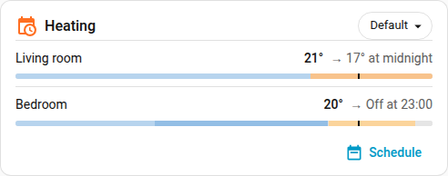
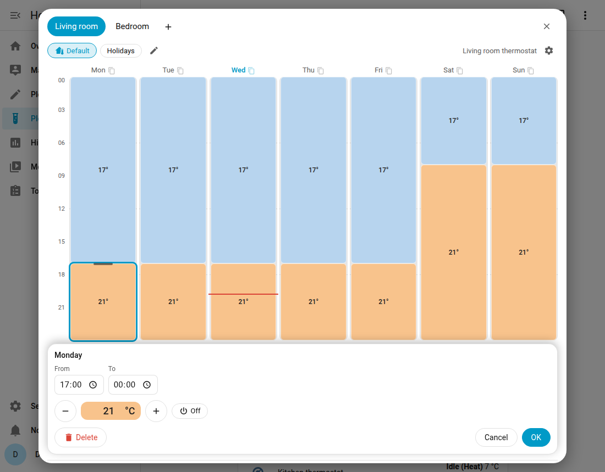

# Ha Plooum Climate Schedule Card

`type: custom:ha-plooum-climate-schedule-card`

Week schedules for your thermostats, with profiles shared by the whole house (Default, Holidays…). The card is the interface of the **[Plooum Climate Scheduler](https://github.com/plooum/HA-Plooum-ClimateScheduler)** integration, which stores the schedules and applies them, even when no dashboard is open: install it first (HACS, custom repository, category *Integration*), then add it in *Settings → Devices & services*.



## On the card

- One row per **program** (a set of thermostats driven together): the temperature of the current slot, the next change, and a strip of today's slots with the current time.
- A thermostat changed by hand keeps its setting until the next change: the row says so (`Bedroom thermostat: 23° by hand until 23:00`) with **Resume** to give it back to its schedule now.
- The **profile** chip switches the whole house to another profile (also `select.climate_scheduler_profile`, for automations).
- **Schedule** (or a tap on a row) opens the week.

## The week



A tab per program, a chip per profile (the house's active one wears a house icon), then the week of the program under that profile: a column per day, the slots colored by temperature, the current time in red.

- **Draw** on a day to add a slot (by 5 minutes), then set its temperature.
- **Tap a slot** to change its times or temperature, turn it **Off** (the thermostats are turned off), or delete it (the slot before takes its time).
- **Drag the top edge** of a slot to move the change.
- **Paint**: pick a color of the palette, then draw or tap slots to give them that temperature; tap the color again to stop.
- **Copy a day**: tap the day's name, pick the days (or Mon – Fri, Sat – Sun, every day), **Copy**.
- **Palette** (🎨): add or remove temperatures. It is shared by the whole house, and only holds shortcuts: a slot takes any temperature.
- **Profiles** (✏️): rename, add or delete profiles (Default can't be deleted). A program without its own week for a profile follows its Default week, shown dimmed; **Make its own … week** copies it to start from.
- **Program settings** (⚙️): name, thermostats (a thermostat belongs to one program), the mode used to turn the heating back on after an Off slot, **The thermostat turns itself off** (for a pellet stove in eco mode or anything that goes to standby: going off is then not a manual change, and the schedule only turns back on what an Off slot turned off), schedule on or off, delete. **+** creates a program.
- **Slot parameters** (in the program settings): switches (`switch`, `input_boolean`) and numbers (`number`, `input_number`) the slots also set, for example a pellet stove's eco mode and hysteresis. Each has an optional name, an icon (`mdi:leaf`…; a number without one shows its value only) and, for a switch, an icon when inactive (otherwise the icon is struck out). A tapped slot then has a line per parameter (**Active** / **Inactive**, or a number). A value holds until a later slot changes it, like the temperature; slots of 2 hours or more show the values in force at their bottom right. Needs Plooum Climate Scheduler 0.3.0.

Changes are kept until **Save**; **Cancel** drops them.

On a phone the dialog fills the screen with the whole week in narrow columns: the round **+** button adds a slot (pick its day, times and temperature), a tap on a slot changes or deletes it, a tap on a day's name copies it, and a color of the palette starts a new slot with that temperature. A drag scrolls instead of drawing.

## Language

The card speaks French when your Home Assistant profile's language is French, English otherwise. The engine's default profile, named *Default*, shows as *Défaut* in French until you rename it.

## Options

| Option | Default | Description |
| :--- | :--- | :--- |
| `title` | `Heating` | Title of the card. |
| `programs` | all | Programs shown, by name or id (the visual editor lists them). The dialog has a tab for each. |
| `show_profile` | `true` | Show the profile switch (hidden anyway with a single profile). |

```yaml
type: custom:ha-plooum-climate-schedule-card
title: Bedrooms
programs:
  - Bedroom
  - Kids
show_profile: false
```
