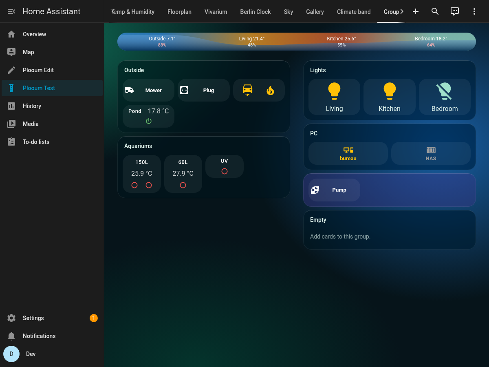

# HA Plooum Group Card

`type: custom:ha-plooum-group-card`

A group of cards on a pane of **frosted glass**: a title, then the cards in a grid. The pane blurs the dashboard's background behind it and tints it with a translucent color, so each family of devices (lights, outside, aquariums...) stands out without a border.



Any card can go in a group, a Plooum card or one of Home Assistant's. Inside the group, the cards get a lighter, translucent background:

- the Plooum cards (button badge, multi status, grid icons, PC) read it from the `--plooum-tile-background` variable;
- Home Assistant's cards read it from `--ha-card-background`.

## The glass

| Look | Settings |
| :--- | :--- |
| Smoked glass (default) | `glass_opacity: 55`, `blur: 20` |
| Lighter glass, more of the background shows through | `glass_opacity: 25` |
| Tinted glass per family | `glass_color: "#3c3489"` on each group |
| Plain translucent pane, no blur (old phones) | `blur: 0` |

The glass color is, in this order: the group's `glass_color`, the theme's `plooum-group-color` variable, or black. The blur needs something behind it to blur: a background image or gradient on the view (or in the theme).

## Configuration Parameters

| Parameter | Type | Default | Description |
| :--- | :--- | :--- | :--- |
| `type` | string | **Required** | `custom:ha-plooum-group-card` |
| `title` | string | none | Title shown at the top of the group |
| `cards` | list | `[]` | The cards of the group, in reading order |
| `columns` | number | `3` | Number of columns of the grid |
| `glass_color` | string | the theme's `plooum-group-color`, or black | Color of the glass (any CSS color) |
| `glass_opacity` | number | `55` | Opacity of the glass color, in % |
| `blur` | number | `20` | Blur of the background behind the glass, in px (`0` = none) |
| `tile_background` | string | `rgba(255, 255, 255, 0.06)` | Background of the cards inside the group |

In a sections view, the group's width is set with Home Assistant's standard `grid_options` (full width by default; `columns: 6` for half).

## Example

```yaml
type: custom:ha-plooum-group-card
title: Lights
columns: 3
cards:
  - type: button
    entity: light.living_room
  - type: custom:ha-plooum-buttonbadge-card
    entity: light.hallway
    name: Hallway
    icon: mdi:ceiling-light
    tap_action_type: toggle
  - type: custom:ha-plooum-multi-status-card
    title: 150L
    temp_entity: sensor.aquarium_temperature
    status_items:
      - switch.aquarium_light
```

The card has a visual editor: title, columns and glass settings, then the list of cards, which can be added (Home Assistant's card picker), edited (each card's own editor), moved and removed.

## A theme for it: Plooum Lagon

[dev/ha-config/themes/plooum-lagon.yaml](../dev/ha-config/themes/plooum-lagon.yaml) is a dark teal theme made for the group card: soft colored halos as the background (no image to load), translucent cards and a `plooum-group-color` for the glass. To use it, copy the file into the `themes/` folder of your Home Assistant configuration, enable themes in `configuration.yaml`:

```yaml
frontend:
  themes: !include_dir_merge_named themes
```

then restart Home Assistant and pick **Plooum Lagon** in your profile, or on a single view with `theme: Plooum Lagon`. A view's own background (view settings → Background) hides the theme's: set it to none.
