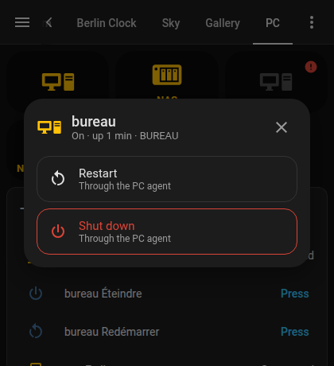

# HA Plooum PC Card

`type: custom:ha-plooum-pc-card`

A single button for a computer run by the **Plooum PC agent** (the `plooum-pc` service of the Plooum website's *Postes* page). The icon's color follows the computer's state; a tap opens a dialog with the actions that state allows:

| State | Button | Dialog |
| :--- | :--- | :--- |
| On | `on_color` | **Restart** and **Shut down** (the agent's buttons) |
| Off | `off_color` | **Turn on** (Wake on LAN) |
| Starting, restarting, shutting down | `pending_color`, pulsing | No action, until the computer answers |
| Sensor unavailable or missing | `off_color`, faded, red mark | A message, no action |



## What the card uses

The agent announces itself to Home Assistant through MQTT discovery: a device named after the computer with an **"En ligne"** connectivity sensor (its attributes are the agent's state: `hostname`, `os`, `since`, and `pending` while a shutdown or a restart runs) and two buttons, **"Éteindre"** and **"Redémarrer"**. Give the card the sensor: it finds both buttons on the same device by itself.

The agent can't turn a computer on, since it only runs on a computer that is already on: **Turn on** sends a Wake on LAN magic packet through Home Assistant, in one of two ways:

- `mac`: calls `wake_on_lan.send_magic_packet`. This service needs the integration enabled in `configuration.yaml`:
  ```yaml
  wake_on_lan:
  ```
- `wol_entity`: presses a button (the one the Wake on LAN integration creates when you add it from *Settings → Devices & services*), or turns on a switch or a script.

The computer must allow Wake on LAN (BIOS/UEFI setting and network adapter option).

After an action, the card shows the transient state (starting, restarting, shutting down) until the sensor confirms it, or until `timeout` runs out (for instance if the computer doesn't wake up).

## Configuration Parameters

| Parameter | Type | Default | Description |
| :--- | :--- | :--- | :--- |
| `type` | string | **Required** | `custom:ha-plooum-pc-card` |
| `entity` | string | **Required** | The agent's "En ligne" sensor (`binary_sensor.<name>_en_ligne`) |
| `name` | string | the device's name | Name shown in the dialog (and on the button with `show_name`) |
| `icon` | string | `mdi:desktop-tower-monitor` | Icon of the button |
| `show_name` | boolean | `false` | Show the name under the icon |
| `mac` | string | none | MAC address for `wake_on_lan.send_magic_packet` |
| `broadcast_address` | string | none | Address to send the magic packet to (the service's default otherwise) |
| `broadcast_port` | number | none | Port to send the magic packet to (the service's default otherwise) |
| `wol_entity` | string | none | Instead of `mac`: a `button`, `input_button`, `switch` or `script` that wakes the computer up |
| `reboot_entity` | string | found on the device | The agent's restart button |
| `shutdown_entity` | string | found on the device | The agent's shutdown button |
| `timeout` | number | `120` | Seconds after which the card stops waiting for the computer after an action |
| `on_color` | string | `#FFC107` | Icon color when the computer is on |
| `off_color` | string | `#9E9E9E` | Icon color when the computer is off |
| `pending_color` | string | `#03A9F4` | Icon color while waiting for the computer |

With neither `mac` nor `wol_entity`, the dialog of a computer that is off says that Wake on LAN isn't set.

## Examples

```yaml
type: custom:ha-plooum-pc-card
entity: binary_sensor.bureau_en_ligne
mac: "AA:BB:CC:DD:EE:FF"
```

```yaml
type: custom:ha-plooum-pc-card
entity: binary_sensor.nas_en_ligne
wol_entity: button.wake_on_lan_aa_bb_cc_dd_ee_ff
name: NAS
icon: mdi:nas
show_name: true
```
